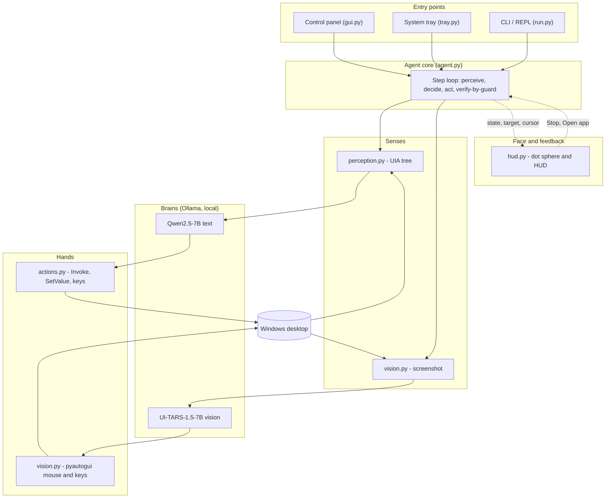
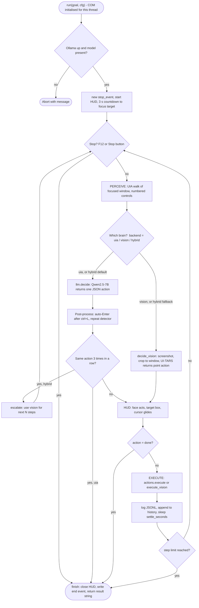
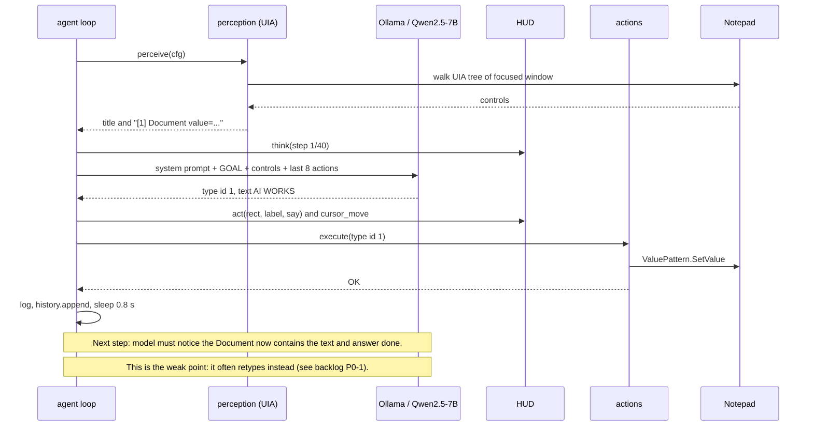
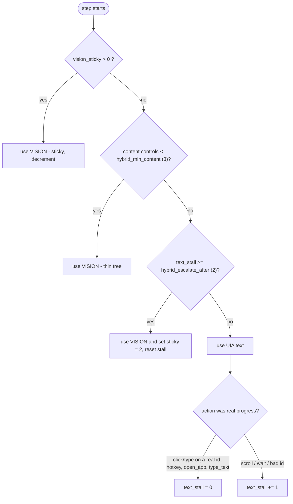
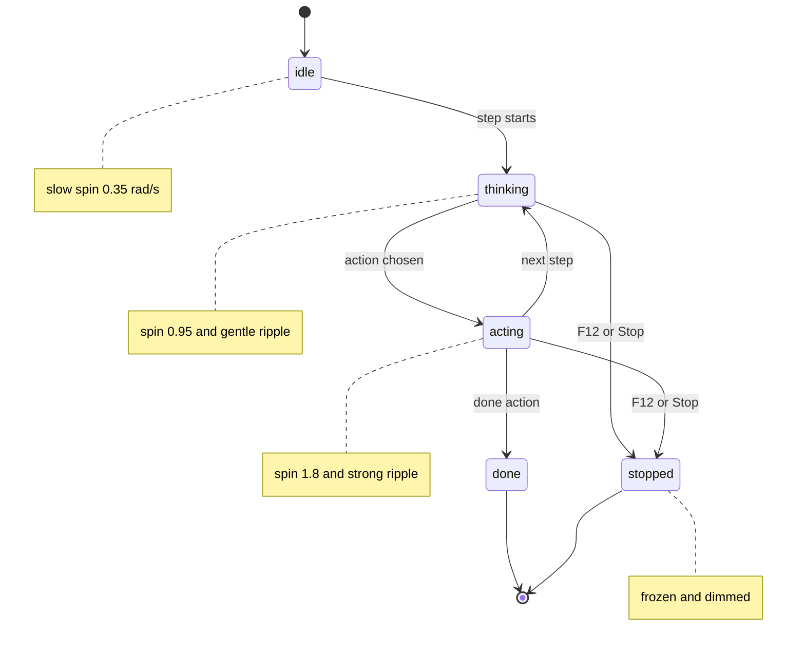

# LocalPilot — Current Architecture

> **Snapshot:** commit `1e3d8f7` · 12 commits · 3,709 lines of Python (3,271 in `localpilot/`) · Windows 11 only
> **What it is:** a fully local, open-model desktop agent. It *looks* at the focused window, asks a local LLM
> for **one action**, performs it, and repeats until the model says it's done (or a guard stops it).
> **Nothing leaves the PC** — models run in Ollama on `localhost:11434`.

How to read this file: §1–2 are the big picture, §3–8 the details of each part, §9–12 operations and safety,
**§13–15 are the "what to improve" part** (maturity map, verified-vs-unverified, prioritised backlog).
Diagrams marked *Mermaid* render on GitHub / VS Code; the ASCII ones render anywhere.

---

## 1. The big picture (ASCII)

```
 HOW YOU START IT                                    WHAT THE USER SEES
 ┌────────────┬────────────┬───────────┬─────────┐   ┌──────────────────────────────────────────────┐
 │ Control    │ System     │ CLI       │ REPL    │   │ HUD overlay  (hud.py, 2 layered windows)       │
 │ panel      │ tray       │ run.py    │ run.py  │   │  • dot-sphere face  (drag, right-click menu)  │
 │ gui.py     │ tray.py    │           │  -i     │   │  • status line, speech text, target box,      │
 └─────┬──────┴─────┬──────┴─────┬─────┴────┬────┘   │    pointer line, the agent's own cursor       │
       └────────────┴────┬───────┴──────────┘        └───────────────────────▲──────────────────────┘
                         ▼                                                   │ think/act/done/stopped
              ┌───────────────────────┐                                      │
              │  agent.run(goal,cfg)  │──────────────── overlay API ─────────┘
              │  (one task = one loop)│
              └───────────┬───────────┘
                          │  every step
        ┌─────────────────┼─────────────────────────────┐
        ▼                 ▼                             ▼
 ┌─────────────┐   ┌────────────────────────────────────────────┐   ┌────────────────────┐
 │ PERCEIVE    │   │ DECIDE   (which "brain"?)                   │   │ ACT                │
 │ perception  │   │  ┌─────────────────┐  ┌──────────────────┐ │   │ actions.py (UIA)   │
 │ .py         │   │  │ uia brain       │  │ vision brain     │ │   │ vision.py (mouse/  │
 │ UIA tree →  │──▶│  │ Qwen2.5-7B text │  │ UI-TARS-1.5-7B   │ │──▶│ keyboard coords)   │
 │ numbered    │   │  │ llm.py+prompts  │  │ vision.py        │ │   │                    │
 │ controls    │   │  └─────────────────┘  └──────────────────┘ │   │ Invoke / SetValue /│
 └──────┬──────┘   │      hybrid = pick per step (agent.py)      │   │ Toggle / pyautogui │
        │          └───────────────────┬────────────────────────┘   └─────────┬──────────┘
        │                              │ HTTP /api/chat                       │
        ▼                              ▼                                      ▼
   Windows UI Automation        Ollama (localhost:11434)                 the real desktop
   (COM, per-thread)            qwen2.5:7b  |  UI-TARS GGUF              (Brave, Notepad, …)
```

## 2. System context (Mermaid)



---

## 3. Module map (what each file owns)

| Layer | File | Lines | Responsibility |
|---|---|---:|---|
| **Entry** | `run.py` | 117 | CLI (`--backend`, `--dry-run`, `--confirm`, `--probe`, `--vision-probe`, `-i` REPL …) |
| | `localpilot_app.py` | 8 | launches the control panel |
| | `localpilot/gui.py` | 339 | Tk control panel: task, Run/Stop, settings, live log, orb header |
| | `localpilot/tray.py` | 189 | pystray tray icon + menu, background task runner |
| | `install.py` / `install_startup.py` | 206 / 107 | one-command setup (deps + Ollama + models) / Windows auto-start shortcut |
| **Core** | `localpilot/agent.py` | 349 | **the loop**, hybrid brain switching, repeat guard, auto-Enter, logging |
| | `localpilot/config.py` | 72 | one dataclass with every knob |
| **Senses** | `localpilot/perception.py` | 176 | focused-window UIA walk → numbered "set-of-marks" list |
| **Brains** | `localpilot/llm.py` | 75 | Ollama client for the text brain, forces a single JSON action |
| | `localpilot/prompts.py` | 46 | system prompt + per-step user message |
| | `localpilot/vision.py` | 381 | UI-TARS prompt, screenshot capture/crop/resize, parser, coord mapping, **its own second loop** |
| **Hands** | `localpilot/actions.py` | 274 | executes text-brain actions; app launcher |
| **Face** | `localpilot/hud.py` | 619 | per-pixel-alpha HUD + draggable dot-sphere window + right-click menu |
| | `localpilot/dotsphere.py` | 149 | halftone white-dot sphere renderer (2 ms/frame) |
| | `localpilot/overlay.py` | 458 | `Overlay()` factory; **legacy** tkinter overlay (fallback) |
| | `localpilot/orb.py` | 134 | legacy liquid orb — now only used by the tkinter fallback |

---

## 4. The core loop — one task, step by step



**One step, concretely (Notepad: "type AI WORKS")**



### 4.1 Guards inside the loop (all live in `agent._run_impl`)

| Guard | Trigger | Effect |
|---|---|---|
| Kill key | F12 held, or Stop button / orb menu sets `stop_event` | aborts before the next step |
| Step cap | `max_steps` (40; vision 14) | ends with "max steps reached" |
| Repeat detector | identical `(action, keys, id, text[:20], name)` 3× in a row | **uia:** stop · **hybrid:** escalate to vision |
| Auto-Enter | any `type`/`type_text` right after `ctrl+L` | appends `\n` so the address bar actually navigates |
| Perceive failure | exception in UIA walk | log, wait, retry next step |
| Model error | bad JSON / HTTP error | counts as a stall, retry |
| PyAutoGUI failsafe | mouse slammed to a screen corner | aborts |

---

## 5. Perception — how the agent "sees" (`perception.py`)

It never sends pixels to the text brain. It walks the **UI Automation tree of the focused top-level window**
(skipping its own overlay by title sentinel) and keeps only *actionable* control types:

`Button · Edit · Document · CheckBox · RadioButton · ComboBox · ListItem · MenuItem · TabItem · Hyperlink · TreeItem · SplitButton · Slider` (+ `Menu / ToolBar / Text` only when they have a name; `Text` must also be interactive)

Rules: skip off-screen, skip zero-size, depth ≤ 28, **stop after 70 controls (`max_elements`)**.
Each survivor gets an integer id, and the model sees plain text:

```
ACTIVE WINDOW: Untitled - Notepad
CONTROLS ON SCREEN:
[1] Document "Text editor" value="hello wor"
[2] Button "Settings"
[3] MenuItem "File"
…
```

The id → live UIA control map stays in Python, so the model only ever says `click 3`, never coordinates.
Measured: ~0.2 s for 36 controls. Browsers/Electron apps (Brave 62, ChatGPT 40, Claude 23 controls) expose rich trees.

## 6. The two brains (and the hybrid switch)

| | **uia brain** (default) | **vision brain** |
|---|---|---|
| Model | `qwen2.5:7b-instruct-q4_K_M` (4.7 GB) | `UI-TARS-1.5-7B` GGUF Q4_K_M (5.6 GB, + vision projector) |
| Input | text: goal + window title + numbered controls + last 8 actions | image: screenshot of the focused window (long side ≤ 1092 px) + last 4 actions |
| Output | `{"action":"click","id":7,"say":"…"}` (Ollama `format=json`) | `Thought: …` / `Action: click(point='<point>x y</point>')` |
| Executes via | UIA patterns: Invoke → SelectionItem → Toggle → physical click; `ValuePattern.SetValue` | `pyautogui` click / double / right / drag / type / scroll / hotkey at **mapped screen coords** |
| Latency (measured) | ~4 s warm · ~9 s seen today · **88 s cold load** | ~17 s warm · 41 s seen today · **~118 s cold load** |
| Strong at | native apps, browsers, anything with a UIA tree; precise, no coordinate error | canvas / custom-drawn UI / thin trees |
| Weak at | thin trees; **deciding it's finished**; fragmenting long strings across steps | slow; aim error ~34 px; wanders on cluttered screens; can wrongly claim "task already done" (seen in today's probe) |
| Coordinate handling | n/a | model coords are **image-space** → scaled by `region/sent` size + crop origin → screen px |

### 6.1 Hybrid brain selection (per step)



Real windows measured for the structural trigger: Notepad 17 controls, Brave 62, ChatGPT 40, Claude 23, bare desktop 0 —
so in practice the **stall/repeat escalation** does most of the work, not the thin-tree rule.

## 7. Actions — what the agent can do

**Text brain (`actions.execute`)**

| Action | Params | How it's performed |
|---|---|---|
| `open_app` | `name` | known exe paths (Brave, Chrome, Edge, Firefox) → command table (notepad, calc, explorer, settings, paint, wordpad) → **Start-menu search** fallback |
| `click` | `id` | UIA `Invoke` → `SelectionItem.Select` → `Toggle` → physical click at centre (or always physical with `real_cursor`) |
| `type` | `id`, `text` | focus + `ValuePattern.SetValue`; else select-all + `SendKeys`. If text ends with `\n`: **real keystrokes + Enter** (Chromium's omnibox ignores API-set text on Enter) |
| `type_text` | `text` | `pyautogui.write` into whatever is focused; `\n` → Enter |
| `hotkey` | `keys` | `pyautogui.hotkey` (e.g. `ctrl+l`, `enter`) |
| `scroll` | `dir` | mouse wheel ×3 |
| `wait` | – | sleep ≥ 1 s |
| `done` | `say` | ends the task |

**Vision brain (`execute_vision`)** — `click · left_double · right_single · drag · type(\n=submit) · scroll · hotkey · wait · finished`.

**Not available yet:** clipboard read/write, select-text, window switch/close, file-dialog handling, reading/returning
information to the user (the agent can only *act*, not *answer*), OCR.

## 8. The face and feedback layer (`hud.py`, `dotsphere.py`)

```
 screen (z-order, top → bottom)
 ┌──────────────────────────────────────────────────────────────────────────────────┐
 │ ORB WINDOW  176×176  layered, per-pixel alpha, NOACTIVATE, topmost                │
 │   • NOT click-through, but hit-tested by alpha:                                   │
 │       ball (incl. gaps, via invisible alpha=1 disc) → receives mouse               │
 │       transparent corners → mouse passes through                                  │
 │   • left-drag = move (remembered in %APPDATA%\LocalPilot\orb_pos.json)            │
 │   • right-click = Stop task | Open LocalPilot app | Reset position                │
 ├──────────────────────────────────────────────────────────────────────────────────┤
 │ MAIN HUD   full-screen  layered, per-pixel alpha, CLICK-THROUGH (WS_EX_TRANSPARENT)│
 │   status line · outlined speech text · target box · dashed pointer · agent cursor  │
 ├──────────────────────────────────────────────────────────────────────────────────┤
 │ the real apps (Brave, Notepad …)  ← the agent's own clicks pass straight through   │
 └──────────────────────────────────────────────────────────────────────────────────┘
 Both windows: titled "LocalPilotOverlay" so perception skips them; never take focus
 (WS_EX_NOACTIVATE + MA_NOACTIVATE); frames pushed with UpdateLayeredWindow (premultiplied BGRA).
```

Dot-sphere state machine (spin speed / ripple):



Render cost: dot sphere **~2 ms**; a full-screen HUD frame **~30 ms** when text/cursor is shown (skipped when nothing to draw).

## 9. Threads and processes

```
 python process (GUI)                                       python process (tray)
 ┌──────────────────────────────────────────────┐          ┌──────────────────────────────┐
 │ main thread: Tk mainloop (gui.py)            │          │ main thread: pystray loop     │
 │   ├─ worker thread: agent.run()  ◀── COM init │          │   └─ worker thread: agent.run │
 │   │     ├─ calls Ollama over HTTP             │          └──────────────────────────────┘
 │   │     └─ drives UIA / pyautogui             │
 │   └─ HUD thread: Win32 message loop + render  │   ┌────────────┐      ┌──────────────────┐
 │        (created per task, destroyed at end)   │   │ Ollama      │◀────▶│ GPU (RTX 3050)   │
 └──────────────────────────────────────────────┘   │ localhost   │      │ ~8 GB VRAM       │
                                                     └────────────┘      └──────────────────┘
```

Key rule learned the hard way: **UI Automation needs COM initialised on every thread that uses it.**
`agent.run()` now wraps everything in `UIAutomationInitializerInThread()` — without it the GUI/tray agent saw nothing.
The HUD exists **only while a task runs** (created in `run`, closed in `finally`).

## 10. Entry points, install, packaging

| What | Command | Notes |
|---|---|---|
| Setup | `python install.py [--vision] [--startup]` | pip deps → Ollama (winget / silent download) → server → pull models → verify |
| Control panel | `start_app.bat` or `python localpilot_app.py` | |
| Tray | `start_tray.bat` or `python -m localpilot.tray` | auto-start via `install_startup.py` (Startup-folder `.lnk` → `pythonw`) |
| CLI | `python run.py [flags] "task"` · `-i` REPL · `--probe` · `--vision-probe` · `--check` | |
| `.exe` | PyInstaller one-file (22 MB) | **blocked on this PC by Smart App Control (unsigned)** and stale (built before the dot-sphere and the COM-thread fix) — use the `.bat` launchers |

## 11. Configuration (`config.py`) — every knob

| Group | Knob (default) | Exposed in |
|---|---|---|
| Model | `model` (qwen2.5:7b-instruct-q4_K_M) · `ollama_url` · `temperature` 0.1 · `request_timeout` 120 | GUI (model) · CLI `--model` |
| Loop | `max_steps` 40 · `settle_seconds` 0.8 · `max_elements` 70 · `history_len` 8 ⚠ | GUI/CLI (steps) · **`history_len` is not wired to anything** |
| Perception | `max_tree_depth` 28 · `include_offscreen` False | config only |
| Safety | `kill_key_vk` F12 · `pyautogui_failsafe` · `confirm_each_step` · `dry_run` | GUI + CLI + tray |
| Viewer | `show_overlay` · `show_cursor` · `cursor_move_time` 0.35 · `real_cursor` · `save_screenshots` · `orb_size` 150 | GUI/CLI/tray (some) |
| Backend | `backend` (uia/vision/hybrid) · `hybrid_min_content` 3 · `hybrid_escalate_after` 2 · `hybrid_vision_sticky` 2 | GUI/CLI/tray (backend only) |
| Vision | `vision_model` · `vision_max_side` 1092 · `vision_coord_space` image · `vision_crop_to_window` · `vision_num_predict` 160 · `vision_terse` · `vision_keep_alive` 15m · `vision_max_steps` 14 · `vision_stop_on_repeat` 2 | CLI (`--coord-space`) · rest config only |
| Runtime hooks | `stop_event` · `log_callback` · `open_app_callback` | set by GUI/agent, not user-facing |

**Settings are not persisted** (no settings file): the GUI forgets backend/model/toggles on restart. Only the orb position is saved.

## 12. Logs and observability

Each run writes `logs/run_<timestamp>.jsonl` (one event per line; `--screenshots` adds a PNG per step):

| `event` | Fields |
|---|---|
| `start` / `ping` / `end` | goal, model · ok, message · final |
| `step` | step, title, num_elements, content, **mode** (uia/vision), reason |
| `action` | step, action, result, mode |
| `decide` (vision) | raw model text (≤400 chars), mapped action |
| `error` / `abort` / `stop` / `escalate` | message · step · reason |

There is **no log viewer / replay UI** — logs are read by hand.

## 12b. Safety controls today

✅ F12 kill key · Stop button · orb right-click **Stop task** · `Esc` in panel · `--confirm` per-step approval · `--dry-run` ·
step caps · repeat guard · PyAutoGUI corner failsafe · local-only (no network except localhost) ·
overlay never steals focus (so a stray click can't silently retarget the agent).

✅ **Harness permission gate** (`harness.py`, added after this snapshot): every action is classified
before it runs; pay / send / delete / publish / sign-out clicks and password / card typing pop a
Yes (allow) / No (skip) / Cancel (stop) dialog; fail-safe stop if it can't ask; user block-list and
extra-sensitive words; the prompt now marks on-screen text as untrusted. Covers the text brain, the
vision brain inside hybrid, and the standalone vision loop. 12 unit/loop tests + real E2E in Brave.

❌ **Gaps:** no app/domain allow-list yet · the gate is keyword-based (an oddly-labelled "Pay" button,
e.g. an icon with no name, can slip past it; vision-brain coverage depends on the model naming its
target) · the agent can act on whatever window happens to be focused (see P0-2).

---

## 13. Maturity map — where to invest

Scale: ■ built · □ missing. (5 = excellent). Ratings are my honest read of the code + this session's tests.

| Capability | Level | Why |
|---|:---:|---|
| **Face / feedback UX** | ■■■■□ | transparent dot-sphere, drag + menu, cursor, speech; some legacy code left |
| **Perceive (UIA)** | ■■■□□ | solid on native/browsers; 70-control cap in DFS order, primary monitor only |
| **Act** | ■■■□□ | core set works incl. app launch + submit; no drag/right-click/clipboard/window mgmt in text brain |
| **Install / packaging** | ■■■□□ | installer + tray + startup work; `.exe` blocked; fresh-machine path untested |
| **Decide (reasoning)** | ■■□□□ | purely reactive 7B; fragments long strings; flaky |
| **Safety** | ■■□□□ | good kill/confirm controls; no risky-action guard, no injection defence |
| **Finish / verify** | ■□□□□ | model self-declares "done" and often doesn't; only a repeat-guard backstops it |
| **Memory / learning** | ■■■□□ | persistent per-user history + notes, similar-task recall, History window (memory.py) |
| **Planning** | ■□□□□ | no plan or sub-goals |
| **Testing / observability** | ■□□□□ | JSONL logs; **no test suite in the repo** |
| **Voice in/out** | □□□□□ | none |

---

## 14. What is verified vs. not

**Verified this session (by running it):**

| Area | Evidence |
|---|---|
| Vision parsing + coordinate mapping | 10 action types parse; image-space and 0-1000 mapping exact; crop-origin mapping exact (scratch scripts) |
| Coordinate convention | UI-TARS is **image-space**; Close-button target landed 34 px off |
| Hybrid switching | rich tree stays on UIA; forced-thin switches to vision; crop-to-window keeps vision on the target |
| Overlay | transparent over white/red/grey/near-black (edge deviation 0); focus preserved; **real-mouse tests**: ball catches clicks (0/5 leaked), corners pass (4/4), drag, menu → Stop sets the event, Open-app callback, Reset position, agent clicks pass through |
| Real tasks | Notepad typing (several runs); **Brave → YouTube → play "Kath Lagda – Navaan Sandhu"** completed (after the Enter fix); GUI-thread end-to-end (after the COM fix) |

**Not verified / suspected:**

| Risk | Status |
|---|---|
| Multi-monitor | HUD sized from primary monitor only; `ImageGrab` default is primary — **untested** |
| DPI scaling > 100% | no DPI-awareness declared in the process — **untested** |
| Long tasks (> 15 steps), non-English UIs, elevated (admin) windows | untested (UIA can't drive elevated windows from a normal process) |
| `install.py` on a fresh machine | only the "everything already installed" branch ran; winget / silent-installer branches never executed |
| Hybrid auto-escalation in a *real* thin-tree app | only forced-thin and repeat cases tested |
| Tray menu in daily use | starts/stops cleanly; menu actions only lightly exercised |
| The `.exe` | cannot launch here (Smart App Control) |

---

## 15. Improvement backlog (prioritised)

Legend — **Impact** H/M/L · **Effort** S (hours) / M (a day) / L (days) · **Lands in** = files touched.

### P0 — reliability and trust (do first)

| ID | Problem (evidence) | Idea | Impact | Effort | Lands in |
|---|---|---|:-:|:-:|---|
| **P0-1** 🟡 *partly done: goal check + on-screen evidence (llm.check_goal / goal_missing_terms)* | **Task completion is unreliable.** After typing correctly the model often re-types instead of answering `done` — **3 of the last 5 Notepad runs** did (2 of them ended only via the repeat guard, leaving a stray leading space). `done` is self-declared; nothing verifies the goal. | (a) feed a **"what changed" signal** after each action (control values before/after); (b) cheap **deterministic checks** for common goals (typed text now in Document value; URL/title contains query); (c) a tiny second LLM call "is the goal satisfied? yes/no"; (d) few-shot finish examples in the prompt | H | M | `agent.py`, `prompts.py`, `perception.py` |
| **P0-2** 🟡 *partly done: focus pin (agent._fg_window / _restore_focus)* | **Focus drift:** runs acted on whatever window was foreground — my tests typed into the *Claude* chat and clicked its Files button. | **Pin the target window** (hwnd) at step 1; re-activate before each step; refuse/ask if the foreground changed to an unrelated app | H | M | `agent.py`, `perception.py` |
| **P0-3** ✅ *done (harness.py)* | **No risky-action guard; prompt-injection possible.** Page text goes straight into the prompt; the agent will click Pay/Send/Delete. | confirm-before for sensitive verbs (pay/buy/send/delete/submit/password), app/domain allow-list, wrap on-screen text as *untrusted data* in the prompt | H | M | `actions.py`, `agent.py`, `prompts.py`, `config.py` |
| **P0-4** | **No automated tests.** Everything was checked with throw-away scripts. | `tests/`: `parse_action`, `map_point` (+crop), hybrid decision, repeat guard, JSON extraction, overlay hit-test; one slow Notepad e2e | H | S–M | new `tests/` |
| P0-5 | `.exe` is **blocked by Smart App Control** and stale. | sign it, or ship an installer that uses the signed Python launcher; rebuild after signing | M | M | packaging |

### P1 — capability

| ID | Problem | Idea | Impact | Effort | Lands in |
|---|---|---|:-:|:-:|---|
| P1-1 | **Purely reactive**; long strings get fragmented across steps (URL split into two `type` calls) | tiny **plan first** (3–6 bullets) → each step tagged with the plan item; replan on failure | H | M | `agent.py`, `prompts.py` |
| P1-2 ✅ *done: memory.py + history_len wired* | **Memory = last 8 action strings**; `history_len` config is unused (hard-coded 8 / 4) | wire `history_len`; add rolling summary + "tried and failed" list | M | S | `prompts.py`, `vision.py`, `config.py` |
| P1-3 | **70-control cap in tree-walk order**, not relevance; duplicate Button/TreeItem pairs seen in Claude's tree | rank (visible, in-viewport, named, interactive first), dedupe, show scroll position | M | M | `perception.py` |
| P1-4 | **Two near-duplicate loops** (`agent._run_impl` and `vision.run_vision`); e.g. the vision branch inside hybrid has no repeat detector | one loop + a `Brain` interface (`decide(state) → Action`, `execute(action)`) | M | M | `agent.py`, `vision.py` |
| P1-5 | **Latency**: text 4–9 s/step; per-step sleeps (settle 0.8 + cursor 0.35 + overlay); text model has **no `keep_alive`** (cold load 88 s after idle) | `keep_alive` for the text model; batch obvious sequences (`ctrl+L` + URL + Enter in one step); trim prompt; stream JSON | M | S–M | `llm.py`, `actions.py`, `agent.py` |
| P1-6 | **Action gaps**: drag, right-click, double-click (text brain), clipboard, window switch/close, file dialogs | add actions + executors; `open_url` helper | M | M | `actions.py`, `prompts.py` |
| P1-7 | Agent can only **act**, never **answer** ("what's on this page?") | `report` action + read-page-text / OCR tool; show result in the panel | M | M | `actions.py`, `gui.py` |
| P1-8 | **Multi-monitor / DPI** unhandled | DPI awareness; virtual-screen metrics; `ImageGrab(all_screens=True)`; per-monitor HUD | M | M | `hud.py`, `vision.py` |

### P2 — polish and reach

| ID | Idea | Impact | Effort |
|---|---|:-:|:-:|
| P2-1 | **Skill cache / macro learning:** save successful traces per goal, replay-and-adapt | H | L |
| P2-2 | **Voice:** push-to-talk STT (local Whisper) + optional TTS | M | L |
| P2-3 | **Run replay viewer** (HTML: screenshot + action per step) from the JSONL + `--screenshots` | M | M |
| P2-4 | **Persist settings** (backend/model/toggles) in a config file | L | S |
| P2-5 | Delete or isolate **legacy face code** (`orb.py`, vector avatar in `overlay.py`) — three face renderers exist, one is current | L | S |
| P2-6 | HUD cost: only repaint a **dirty rect / smaller windows** instead of full-screen RGBA each frame | L | M |
| P2-7 | Stronger or different text model that fits 8 GB; A/B on a fixed task set | M | M |
| P2-8 | Fresh-machine install test (VM) + `install.py` branch coverage | M | S |

### Suggested order (my recommendation)

1. **P0-4 tests** (so every change after is safe) →
2. **P0-2 window pinning** + **P0-1 done-verification** (these two fix the failures actually observed) →
3. **P0-3 risky-action guard** (before letting it near real accounts) →
4. then **P1-1 planning** and **P1-5 latency**, and **P2-1 skill cache** as the differentiator.

---

## 16. Repo map

```
C:\reserchagi
├─ run.py                  CLI / REPL entry
├─ localpilot_app.py       control-panel entry
├─ install.py / .bat       one-command setup
├─ install_startup.py      Windows auto-start shortcut
├─ start_app.bat           launch panel (signed Python; works under Smart App Control)
├─ start_tray.bat          launch tray
├─ requirements.txt        uiautomation, comtypes, requests, pyautogui, pillow, pystray
├─ README.md               user-facing docs
├─ ARCHITECTURE.md         this file
├─ localpilot/
│   ├─ agent.py            ★ the loop, hybrid switch, guards
│   ├─ perception.py       UIA → numbered controls
│   ├─ llm.py, prompts.py  text brain
│   ├─ vision.py           vision brain (+ its own loop)
│   ├─ actions.py          executors, app launcher
│   ├─ hud.py, dotsphere.py   current face + HUD
│   ├─ overlay.py, orb.py  legacy tkinter overlay + liquid orb (fallback only)
│   ├─ gui.py, tray.py     control panel, tray
│   └─ config.py           all knobs
├─ logs/                   run_*.jsonl (+ screenshots)   [git-ignored]
└─ dist/                   LocalPilot.exe                [git-ignored, blocked here]
```

**Models (Ollama):** `qwen2.5:7b-instruct-q4_K_M` (text) · `hf.co/Mungert/UI-TARS-1.5-7B-GGUF:Q4_K_M` (vision) ·
**Hardware this was built/tested on:** RTX 3050 (~8 GB), 24 GB RAM, i3-10105, Windows 11.


## Speed layers (v0.9.1)

Each layer of the loop (command → harness → action model → executor → observe/verify) got its own fast path:

| Layer | Fast path | Effect |
|---|---|---|
| Harness | `apps.py` indexes every Start-menu app (`Get-StartApps`, cached in `%APPDATA%\LocalPilot\apps.json`) and launches it via `shell:AppsFolder`. "Open X" goals finish **without the model** once X's window is in front. "Open <browser> and go to <url>" starts the browser directly at the URL. | open any app: about 1 s |
| Action model | `127.0.0.1` instead of `localhost` (Windows IPv6 lookup cost **about 2 s per call**); `keep_alive=30m`; warm-up when the panel opens and while a run starts; `num_predict` cap | about 4 s saved per step |
| Executor | a URL typed into a browser always goes to the address bar (Ctrl+L first) | no typing into pages |
| Observer | `_settle` returns as soon as the UI changes and holds still (capped by `settle_seconds`); `_wait_ui_ready` waits for a launched app's controls to stop appearing | no fixed sleeps; no acting on half-loaded windows |

Battery (7 real tasks, `uia` backend) before → after: Calculator maths 31 → 3 s (clear + type once, no model), Notepad 20 → 9 s, Brave and a URL 22 → 2 s,
Settings › Bluetooth 24 → 14 s, Explorer › Downloads 21 → 9 s, open-only goals about 1 s; 7/7 passed with 0 false claims.

## Web layer (v0.9.2)

`web.py` reads a goal as *browser + site + query* before the model runs.

- **Search on a site** ("search YouTube for X", "go to amazon.com and search X", "X on youtube in brave"):
  the site's own results page opens directly (about 25 known sites).
- **Search the web:** the browser's own engine (Brave Search for Brave, Google for Chrome, Bing for Edge).
- **Unknown site:** LocalPilot opens it, finds the page's own search box (an Edit or ComboBox named "search"),
  selects all, types once and presses Enter once.
- **No browser named:** the Windows default browser is used. The `UserChoiceLatest` key is read first,
  because the older `UserChoice` key can be stale.
- **Done** requires the results to be open: the search words are in the title, or in the address-bar URL.
- **Executor:** typing into a field whose text already matches only presses Enter (covers autocomplete).
  Otherwise it selects all first, so the text replaces what's there instead of being appended.
- **Focus pin:** after opening an app, LocalPilot works in the new window, never the one that was in front.

Browser battery before → after: 0/9 with 4 false claims → 9/9 with 0 false claims, mostly 1–4 s per search.

## Task skills (v0.9.3)

A wider set of 15 everyday tasks went from 9/15 to 15/15. Each failure was traced to its root cause:

| Skill | What it does |
|---|---|
| Settings pages | "Settings › Display / Sound / Wi-Fi …" opens `ms-settings:<page>` directly (about 40 pages) |
| In-app search | "Open Settings / File Explorer (go to Downloads) and search for X" uses the app's own search box |
| Folders | "Open Explorer and go to Downloads/Documents …" opens the folder itself |
| Maths | percentages ("15 percent of 200"); exact answer check before the keyword guard |
| Typing check | reads the editor, not the window title (the title shows one line, so the model retyped a list three times) |
| Save as | `save_as` action plus auto-save when the goal says "save it as <path>"; types the path (the dialog ignores UIA SetValue) and never overwrites an existing file |
| Search follow-ups | "...and play the first video" clicks YouTube's first `video-title` link; Wikipedia goes straight to the article (`go=Go`) |
| Open a site | "Open youtube.com" opens it in the default browser |
| Honest failure | an app that isn't installed stops at once with a plain message |
| Focus | after the *model* opens an app, LocalPilot works in that app (it used to return to the previous window) |

All three batteries together: 31/31 tasks with 0 false claims; most tasks take 1–9 s.
